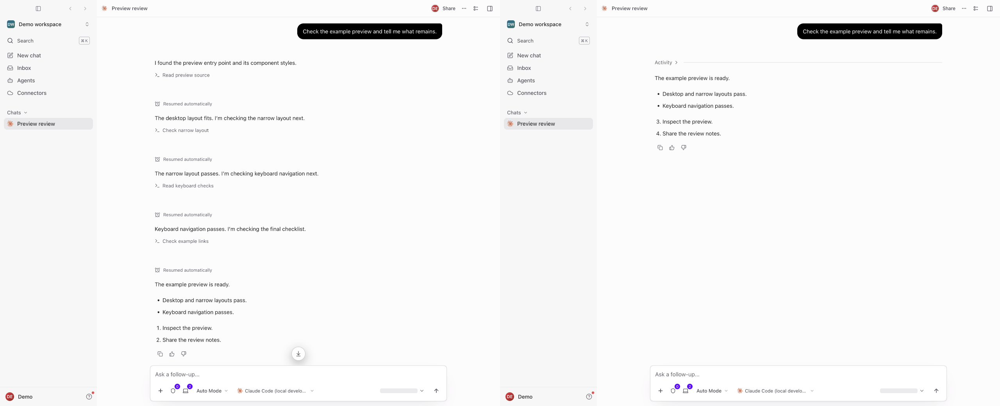
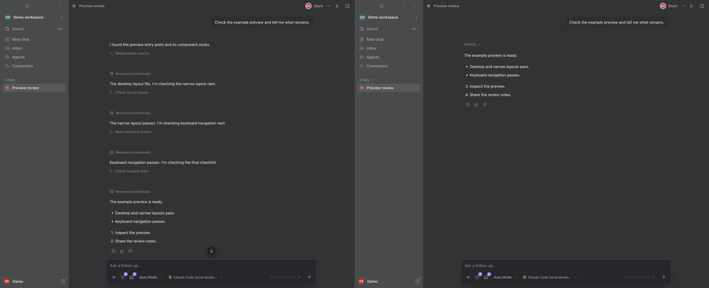

# Chat activity presentation

Proposed on `feat/chat-activity`; no deployment is implied.

Earlier explicit commentary and successful plain tool calls share an expandable
Activity row. The newest text, final answers, active calls, approvals, failures,
user steering, cards and files remain visible. Expanding restores original text,
message IDs, controls and timestamps. This changes presentation, not how much the
model writes. Unknown phases are not guessed or rewritten.

`openab-text-updates.ts` retains native messageId and the recognized Codex phases
commentary/final_answer. `preview-transcript.ts` preserves message boundaries;
the prompt and autonomous routes emit matching text-start frames. Desktop
applyEvent, persistence and toUiMessages preserve these fields through stream,
reload, request and transcript sync. Legacy framing is retained. Existing
mid-turn credential renewal and runtime-output token redaction from main remain intact.
The redaction buffer keeps ordinary text ownership across native message boundaries;
if one redacted credential spans owners, its sanitized output stays unphased
instead of guessing a source-message classification.

`panel/activity.ts` owns grouping and protects user/timeline/file boundaries.
`renderPartRange.tsx` selects parts before constructing tool runs, preventing
empty or duplicate headers. ToolRunView, ToolPartView and turnFold keep explicit
failures and approvals visible, including interrupted turns and structured
nonzero exit codes. SessionFindBar explains how to search collapsed activity.
Continued ordered Markdown lists keep their starting number.

Evidence now uses the full Electron application: unchanged baseline42d7757 and this feature branch, each loading the same neutral seeded transcript through a real local backend/database and desktop IPC. Both1280×1040views are scrolled to the top. No tools were executed by the seeded transcript; the recording exercises the actual Activity controls. There are no added labels, readouts or overlays.

Native checks in light and dark confirm one Activity row, all four progress messages and tool identities restored on expansion, and continued list numbering3–4 instead of1–2. The full-app check exposed a nested disclosure bug: a Journal tool target could remain hidden inside a closed tool group after Activity opened. Tool groups now use the same disclosure contract, and lookup opens each closed owner before scrolling to the real target. Two new focused regressions and the actual app check cover this path.

This is presentation grouping, not a fix for runtime turn segmentation tracked separately in issue704. It does not reduce generated text or promise every conversation will be concise. Unknown phases, errors, pending approvals, cards and files retain their conservative behavior.

Before is left, after is right.

[Native expand/collapse recording](images/chat-activity/activity-app.gif)

[Full light before](images/chat-activity/light-before.png) · [Full light after](images/chat-activity/light-after.png) · [Full dark before](images/chat-activity/dark-before.png) · [Full dark after](images/chat-activity/dark-after.png)
